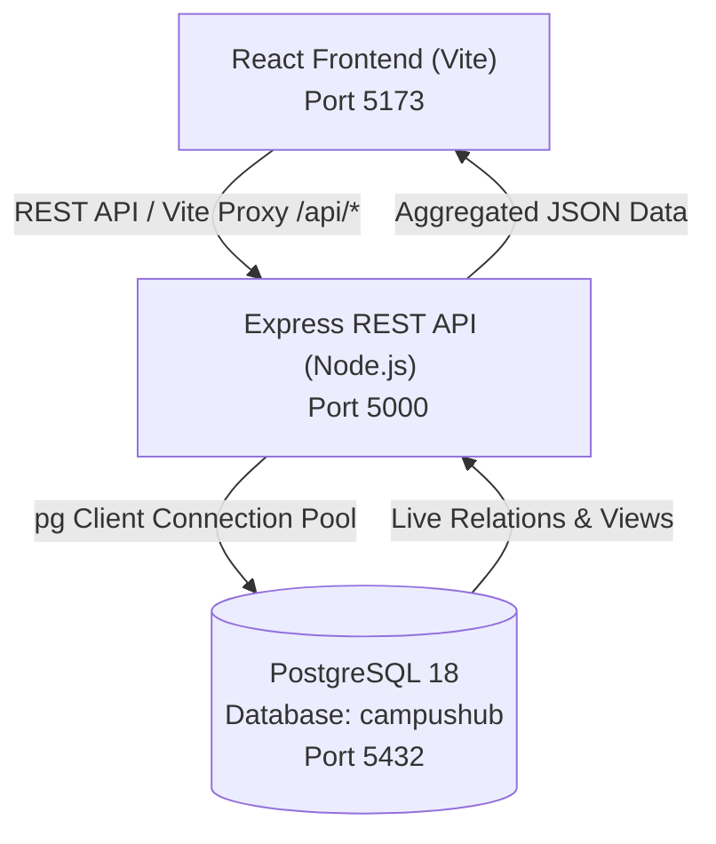

# CampusHub — College Event Registration & Budget Tracker
> **DBMS Mini-Project**: A full-stack relational database management system built with React, Node.js/Express, and PostgreSQL 18.

---

## 🏛️ System Architecture



### 1. **Database Layer (PostgreSQL 18)**
- **Database**: `campushub`
- **8 Normalized Relational Tables**:
  - `Venues`: `id` (PK), `name`, `capacity` (`CHECK (capacity > 0)`)
  - `Events`: `id` (PK), `name`, `date`, `venue_id` (FK), `base_budget` (`CHECK (base_budget >= 0)`)
  - `Organizers`: `id` (PK), `name`, `email` (`UNIQUE`), `role`
  - `Participants`: `id` (PK), `name`, `email`, `roll_number` (`UNIQUE`)
  - `Registrations`: `event_id` (FK), `participant_id` (FK), `registration_date` — **Composite Primary Key** `(event_id, participant_id)`
  - `Attendance`: `event_id` (FK), `participant_id` (FK), `check_in_time`
  - `Sponsors`: `id` (PK), `event_id` (FK), `sponsor_name`, `amount_contributed`
  - `Expenses`: `id` (PK), `event_id` (FK), `budget_head`, `amount`, `spent_by`
- **4 SQL Views**:
  - `vw_financial_summary`: Computes base budget + sponsorships − expenses per event.
  - `vw_attendance_report`: Calculates registrations, attendance %, and venue fill % via multi-table JOINs.
  - `vw_expense_by_category`: Aggregates expenses by budget head with % breakdown.
  - `vw_event_participants`: Lists students registered for each event along with their check-in status.

### 2. **Backend Layer (Express + `pg`)**
- Located in `server/index.js` and `server/db.js`.
- Features real SQL query logging, parameterization (`$1, $2, ...`) for SQL injection prevention, and PostgreSQL error code mapping (23505 Unique Violation, 23503 Foreign Key Violation, 23514 Check Violation).
- REST endpoints for CRUD operations and live custom SQL query execution.

### 3. **Frontend Layer (React 19 + Vite)**
- Dynamic responsive UI with modern typography, glassmorphism, and color-coded status badges.
- **Pages**:
  - **Dashboard**: High-level KPI metrics, recent registrations, and budget status.
  - **Event Management**: Create, edit, and delete events with cascade behavior.
  - **Student Registration**: Form enforcing unique roll numbers and composite PK registration constraint.
  - **Attendance Tracker**: Event-specific participant check-in and check-out management.
  - **Budget & Finance**: Track sponsorships, categorized expenditures, and real-time remaining budget.
  - **Reports & Analytics**: Live visualization of SQL views, fill percentages, and SVG expense breakdown.
  - **🐘 PostgreSQL Console**: Built-in interactive SQL terminal to run queries directly on `campushub`.

---

## 🚀 Quick Start

### 1. Requirements
- Node.js (v18+)
- PostgreSQL 18 running on `localhost:5432` with a `postgres` user

### 2. Configure Environment (`.env`)
Ensure your `.env` contains:
```env
PORT=5000
PGHOST=localhost
PGPORT=5432
PGUSER=postgres
PGPASSWORD=Admin
PGDATABASE=campushub
```

### 3. Initialize Database (Already executed or via script)
```bash
# If resetting or initializing for the first time:
psql -U postgres -d campushub -f schema.sql
```

### 4. Run the Full Application
Start both the Express backend and the Vite frontend simultaneously with:
```bash
npm start
```
- **Web App**: Open [http://localhost:5173](http://localhost:5173)
- **API Server**: Running on [http://localhost:5000](http://localhost:5000)
- **PostgreSQL Database**: Connected to `campushub` on port 5432
